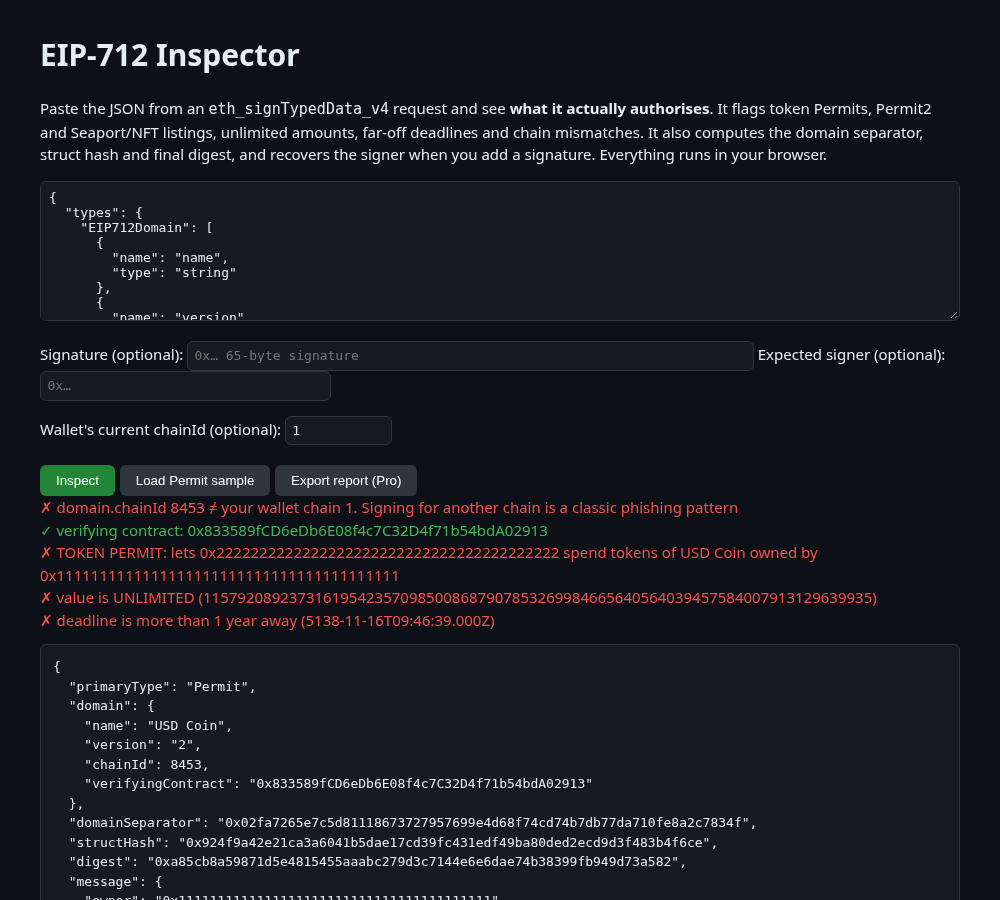

# EIP-712 Inspector

**Live:** https://dansgit2b.github.io/eip712-inspector/

Paste an `eth_signTypedData_v4` payload and see **what the signature authorises** before you sign it, or check a signature you received.

- **Risk flags:** ERC-2612 token Permits (including DAI-style `allowed`), Uniswap Permit2 (`PermitSingle`, `PermitBatch`, `PermitTransferFrom`…), Seaport/marketplace orders with zero consideration, delegations, EIP-3009 transfer authorizations, unlimited amounts, deadlines years in the future, and `chainId` that doesn't match your wallet's chain.
- **Hashes:** domain separator, struct hash and the final EIP-712 digest.
- **Verify:** recovers the signer from a 65-byte signature and compares it with the address you expect.
- Runs 100% in the browser (static page, bundled [viem](https://viem.sh)); nothing is uploaded.

## Pro pass (0.10 USDC)
Inspecting is free. The Pro pass adds Markdown audit-report export. All payments go straight to the Lumen Works wallet `0xee9790cB3960952F585379F831a89b4e00B4029A` (USDC on Base or Arc) and are checked on-chain by the page itself. No account and no backend. The code is MIT, so you could remove the check; the pass is an honest way to fund upkeep.

## More from Lumen Works
- [x402 Inspector](https://dansgit2b.github.io/x402-inspector/): decode and lint x402 payment headers ([repo](https://github.com/Dansgit2b/x402-inspector))
- [EIP-712 Inspector](https://dansgit2b.github.io/eip712-inspector/): see what a typed-data signature authorises, with hashes and signer recovery ([repo](https://github.com/Dansgit2b/eip712-inspector))
- [Calldata Decoder](https://dansgit2b.github.io/calldata-decoder/): decode EVM calldata and multicalls without an ABI, with risk flags ([repo](https://github.com/Dansgit2b/calldata-decoder))
- [Lumen Tab](https://dansgit2b.github.io/lumen-tab/): pay-as-you-go micropayment tabs for agents on Arc ([repo](https://github.com/Dansgit2b/lumen-tab))

MIT © Lumen Works. Not a security guarantee; when in doubt, don't sign.

## Support this project

This tool is free and MIT-licensed, maintained by one developer. If it saved you time, a tip of any size keeps it maintained:

- **USDC on Base or Arc:** `0xee9790cB3960952F585379F831a89b4e00B4029A`
- Drips: this repo has a `FUNDING.json`, so it can receive funds and dependency splits through [Drips](https://www.drips.network/).

Thank you!
